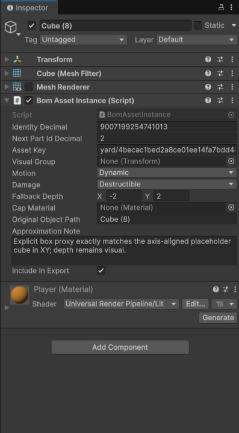
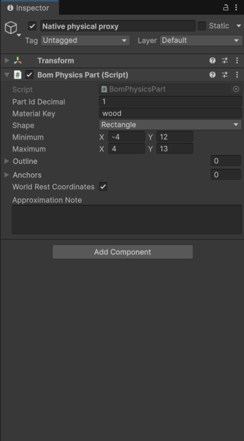

# Artist guide: add an object to the network yard

Odin decides what a thing is made of and how it breaks; Unity only shows it. So every object you add needs a small
**physical proxy** (a flat 2D shape plus a material) that the Odin server turns into breakable cells. Your art mesh is
what players see until the object first breaks. Screenshots below are from the real Unity 6000.2.14f1 Editor.

Tested: on a copy of the project I duplicated a yard cube, made it glass, moved it up and exported; the native server
accepted it (`LEVEL PASS`, 17 sources, protocol 7). Evidence: `review/task3-20261110/artist-guide/artist-yard2.json*`.
Not yet tested: playing a build that contains such a new object (see "See it in game").

## 1. Open the scene and add the object
1. Open `Assets/BOMIntegration/NetworkYard.unity`. Everything that takes part is under the root with the
   **Bom Level Authoring** component. Objects outside that root are scenery only; they never collide or break.
2. Easiest start: select an existing yard object (e.g. `Cube`), duplicate it (Ctrl+D) and move/replace its mesh.
   For a new object, add it under the level root and add the **Bom Asset Instance** component.

## 2. Solid or destructible (Bom Asset Instance)

- **Motion**: `Dynamic` falls and gets pushed; `Anchored` is fixed to the ground but can be cut away; `Fixed` never moves.
- **Damage**: `Destructible` breaks; `Indestructible` ignores damage (walls, floors).
- **Asset Key**: any unique text for this mesh (objects that share a key must share the same mesh). Leave `Include In Export` ticked.
- Anything without these components is not solid in the game.

## 3. Material and 2D footprint (Bom Physics Part)
Add a child object (for example `Native physical proxy`) with **Bom Physics Part**:


- **Material Key**: `wood`, `glass`, `rubber` or `stone` (or a custom name listed under the level's Materials).
  The material sets toughness and how it cracks; it is not taken from the art material.
- **Shape / Minimum / Maximum**: a rectangle (or wedge/polygon) in XY. Depth only affects the look.
- **World Rest Coordinates** (ticked on existing yard objects): Minimum/Maximum are **absolute scene positions**, so moving
  the object does **not** move its footprint. After moving, retype Minimum and Maximum to match where it now sits
  (the test cube above needed X -1..7, Y 14.5..15.5). Untick it to make the footprint follow the object instead.
- Parts that touch glue together only if listed under **Glue**; overlaps with other parts are rejected unless listed under
  **Allowed Overlaps** with a reason, so keep new objects clear of others.

## 4. Preview the footprint
Select the part object: its footprint is drawn as a green outline in the Scene view (Scene view, gizmos on). If the green
box does not cover your art in XY, fix Minimum/Maximum. (The captures in this guide are the Inspector; the Editor's
capture tool does not render gizmos.)

## 5. Export
1. **Save the scene (Ctrl+S) first.** The export reloads the saved scene, and unsaved changes are lost.
2. There is no menu item yet. Run the exporter from the command line with the Editor closed:
   ```powershell
   $env:BOM_YARD_LAYOUT_OUT = "<repo>\integration\fixtures\network-yard\yard.json"
   $env:BOM_NATIVE_SERVER_EXE = "<native build>\BOM-server.exe"   # path printed by Build-OwnerNative.py
   & "C:\Program Files\Unity\Hub\Editor\6000.2.14f1\Editor\Unity.exe" -batchmode -quit -projectPath "<repo>" `
     -executeMethod BomYardBuilder.CreateAndExport -logFile export.log
   ```
3. The Odin server validates the result and writes `yard.json.validation.log`. You need `LEVEL PASS`. Any error message
   (overlap, missing material, duplicate key, ...) names the object; fix it and export again.

## 6. See it in game
Rebuild a player (`integration/tools/Build-BomPlayers.ps1 -Backend Mono`, about 20 minutes), then run
`integration/tools/Start-BomNetwork.ps1` and look for the object in the yard; fire a blast at it with the host window.
If it is missing, check `Include In Export` and the validation log.
