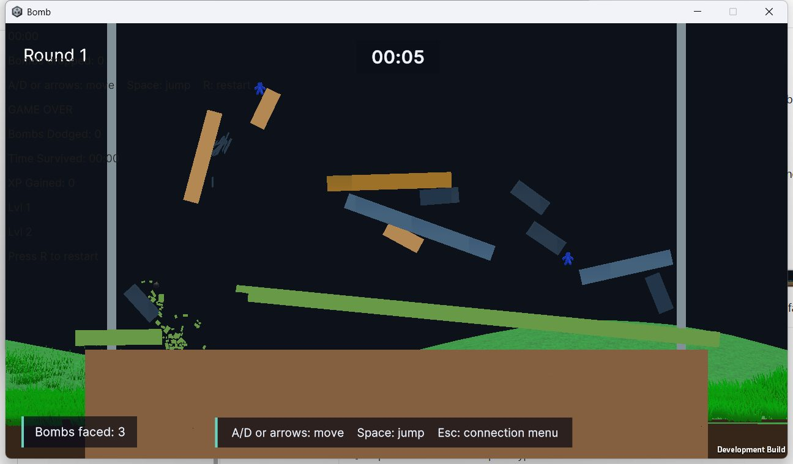
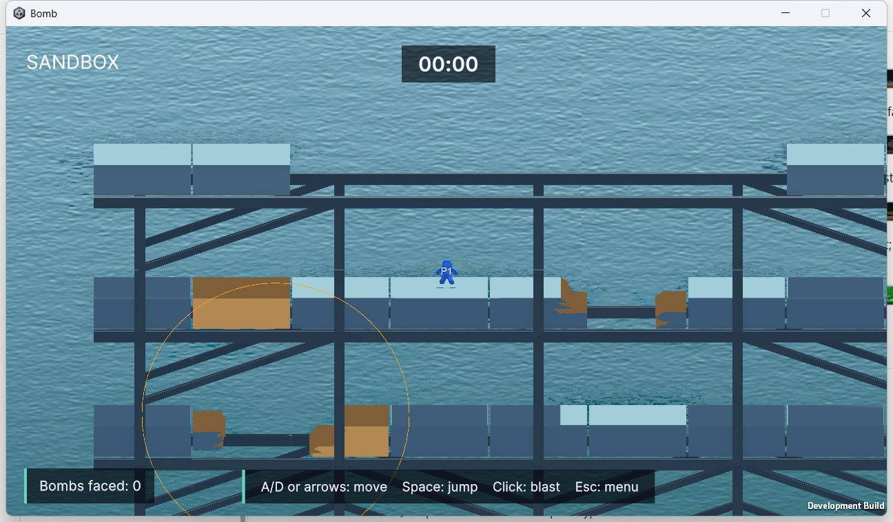
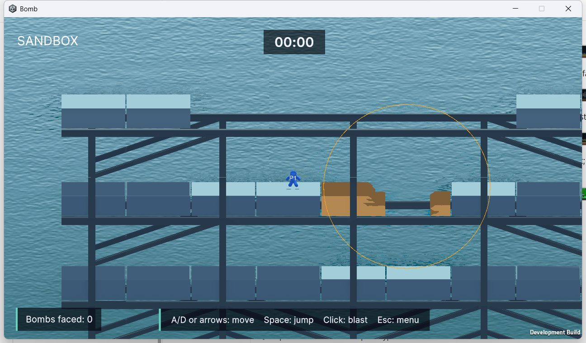
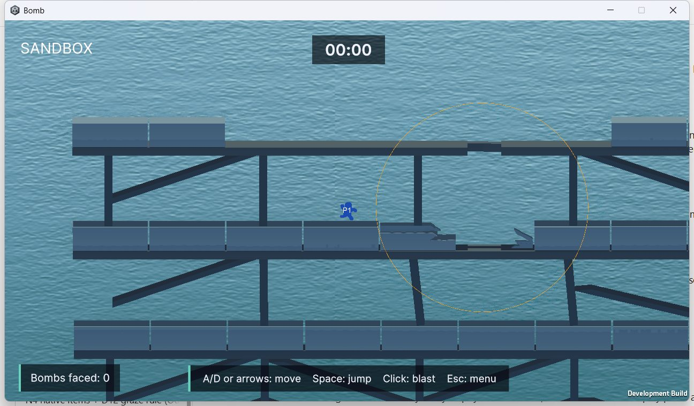
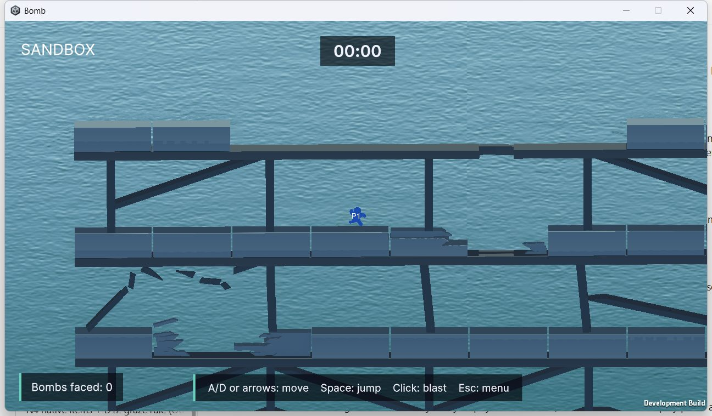

# G1: Odin destruction in Darryn's 2.5D (design spike, 2026-11-12)

Author: Claude Opus 5.5 (task G1). Inputs: owner principle in `integration/ALPHA-SYNC.md` Phase G; captures in
`integration/review/destruction-2026-11/`; F2 report `integration/review/performance-2026-11.md`; layout contract
`integration/contracts/level-layout-v4.md`; Odin `alpha-sync` 3aed89e (read only).

The owner's principle, which this design does not trade away:

- The destruction is the soul of the game. Every piece is a simulated, interactable body sent over the wire.
- **What's there is what you get.** What you see is exactly what you collide with, and it all fits together intuitively.
- Toughness comes from the owner's tuned **materials** and **connectors/glue**. Never from an indestructible flag or a
  decoration-only status.

## 1. Summary

**What went wrong.** The merge kept Odin's simulation but lost how it *reads*:

1. Every fragment is extruded to its tile's full depth: 4 units on the Bridge, 10–11 on the yards. So a 0.2-unit chip
   is drawn as a 0.2 × 0.2 × 4 stick, and a crater is drawn as a narrow slot through the level.
2. C6 turned half of Darryn's level into non-physical decoration: 88 of 110 Bridge tiles, 29 Tower pillars and
   8 Yard pillars. Every "Carve" tile is anchored on every edge, so blasted decks never drop debris. Overlaps were
   trimmed, nothing is glued, and the walls are indestructible.
3. Any change to a level rebuilds all of its meshes (F2 cause 1). That is where the explosion lag comes from.

**What I recommend.**

- **Layout:** turn Darryn's tiles into an Odin authored layout. Each tile becomes a part with a real material.
  Front/rear duplicates merge onto the play plane. Where tiles overlap, the plane is split between them and the shared
  seam is glued. Anchors go only where something rests on ground. Nothing is indestructible.
- **Depth:** draw each piece at a depth set by its own area, `depth = clamp(√area, 0.1, band)`, inside a
  **1.6-unit play band**. The same native data gives the same picture on every client. Darryn's extra depth becomes
  backdrop: a darker back wall behind terrain, and his scenery behind structures.
- **Presentation:** meshes persist and are split into chunks. A chunk is rebuilt only when its own cells change.
  Darryn's meshes are not clipped per fragment.

**The prototype works.** The flag is `--bom-g1`, the level is the G1 Bridge (`integration/fixtures/levels-g1/`), and
`integration/tools/g1/Start-BridgeG1.ps1` launches it. Darryn's 110 tiles become 52 physical parts with 97 glue links
and 5 anchored truss feet. It passes native validation and stands on the real server, and a blast now splinters the
planks, drops the bay and piles debris on the deck below. Measurements are in section 6.

**Owner decisions needed:** the boundary (section 3.5), the material table (section 3.2), how Bridge supports work
(section 3.4), and the band depth and backdrop look (section 4). The task list is in section 8.

## 2. Captures and what is lost

Same idea in each source: a blast into a solid mass and one into a structure; one frame about 0.35 s after the blast
and one after it settles. Raw logs and the capture scripts are in `integration/evidence/G1/captures-20261112/`.

| # | Source | Frame | What it shows |
|---|---|---|---|
| 01–04 | Odin raylib sandbox, `--capture-frames` (deterministic falling bombs on the 17 × 3 destructible floor + 4 material blocks) | start, mid-blast, 10 s, 40 s |  Crater with 0.3–1 unit chunks; debris fills it and stays; blocks tumble into the crater |
| 05–09 | Odin sandbox, interactive: stone piers + mortared wood deck + wood posts + glass (layout in evidence `tools/sandbox-structure-layout.json`) | start, 0.35 s, settled |  Splinters hang from mortared deck ends; the broken plank leans into the crater; chunk sizes read immediately |
| 10–13 | Pre-merge package `BOM-Windows` (classic yard, Elimination bombs) | start, round start, blast, settled |  Small green chips burst from the grass plank. The stack topples at the start (C2b) |
| 14–17 | Current package `2026-11-12b`, Classic Yard | start, 0.35 s, settled |  A table leg breaks into long sticks; the ground crater is a thin slot; tile colours pop between intact and fragment art |
| 18–21 | Current package, Bridge | start, 0.35 s, settled |  Clean holes in the decks, no flying debris, truss untouched inside the blast radius, blasted tiles turn from blue to tan |

Notes on the runs. In the pre-merge package every scripted click came back `status=3` (Expired), which is the
pre-C2e click-timestamp bug, so its blasts are Elimination bombs instead. Its first one-window attempt timed out while
connecting (slow 12 s first load); the two-window rerun was clean. The sandbox's own interactive window cropped under
150 % DPI, so it ran with `__COMPAT_LAYER=DpiUnaware`.

**What is lost, concretely:**

| Quality | Odin (sandbox, pre-merge) | Now (2026-11-12b) | Cause |
|---|---|---|---|
| Piece size and density | Chunks 0.1–1 unit, many per crater (sandbox frame 600: ~150 in one crater); chips read as chips | The same cells in the sim (native is unchanged), but drawn 4–11 units deep, so each chip is a stick or slab and density reads as "a few planks" | Extrusion depth = the source's `depth` interval (`BomClientBehaviour.Accept` fallback; `BomSourcePresentation` clips Darryn's whole-depth mesh by each cell's prism) |
| Depth / stick look | Flat 2D (sandbox); thin slabs (pre-merge classic yard) | Long sticks (Classic Yard table legs, frame 17); deck fragments are full-depth blocks | Same |
| Tumble and settle | Pieces tumble, roll into the crater and settle on each other (sandbox 03–04) | Bridge: nothing falls; holes only (frames 19–21). Classic Yard: the table falls but its legs are sticks | C6 "Carve → anchored on every edge": every piece that still touches the original outline stays pinned |
| Crater readability | A bowl outlined by the chunk edges | A thin vertical slot through 10–11 units of ground (frame 17); colour pop at the hole's edge | Full-depth extrusion; intact art vs fragment palette |
| Standing on / pushing debris | Debris is walkable and pushable everywhere | Little debris exists on the Bridge. The truss looks solid but is decoration you pass through | C6 off-plane decoration; anchored-every-edge decks |
| What you see is what you hit | Yes | No: Bridge truss (88 tiles), Tower pillars (29), Yard pillars (8) are drawn but not physical; invisible indestructible walls | C6 mapping |
| Explosion moment | Immediate | Classic Yard: about 0.35 s after a blast the scene has not yet changed (frame 15); F2 measured 25–35 s rebuild windows | Full rebuild per revision (F2 cause 1) |

## 3. Design A: Darryn's tiles as an Odin authored layout

### 3.1 Invariants (checked by the exporter, so a level that breaks one fails to export)

- **I1 Physical = visible.** Every tile inside the arena is a part, or a declared backdrop (behind the band, darker,
  no walkable top). Nothing is "off-plane decoration".
- **I2 No indestructible.** No source is `indestructible`, and no source is `fixed` unless it is invisible boundary
  geometry the owner chooses to keep (section 3.5).
- **I3 Anchors only at real support.** Anchor segments sit only on edges that rest on ground or bedrock (or a wall, if
  the owner keeps walls). Never "anchored on every edge".
- **I4 Toughness from materials and glue.** Each part has a palette material; joins are glue links. No `allowed_overlaps`.
- **I5 Settles.** A spectator on the real server sees the world revision stay constant for 35 s with no blasts
  (C2b check).

### 3.2 Mapping rules (the G1 Bridge generator implements them: `integration/tools/g1/Build-BridgeG1.py`)

1. **Tile → part.** The outline is the tile's XY silhouette from its world transform. Rotated boxes become rotated
   quads (the Bridge braces are ±18.7°). Non-box meshes, such as the Yard rocks, need an authored proxy, as today.
2. **Front/rear duplicates merge.** Tiles with the same XY outline become one part, and the report keeps both paths.
   On the Bridge, 110 tiles become 67 members. Members that only existed off-plane (truss, pillars) come onto the plane.
3. **Overlaps → partition + glue, never a gap.** When two members overlap in XY, the continuous member keeps the
   overlap and the other is cut at its face. The priority is ground > decks and girders > posts > braces. The new
   shared edge gets a glue link. Example: posts that ran through the decks become runs between decks, and braces are
   clipped to the post and girder faces. This is not C6 trimming. C6 trimmed only to get past native's overlap check
   and left the tiles unconnected. Here every cut becomes a glued seam, so the structure holds by its connectors.
4. **Glue every contact.** Glue goes on every pair within the native glue fillet (0.2 units). Darryn's 0.07 gaps
   between deck tiles, the 0.02–0.03 deck-on-girder gaps and the cut faces are all glued. Blast strength comes from
   the materials: native fails a glue seam at `min(connection_strength)` of the two parts (`sim_destruction.odin:370`).
   Load strength does not yet come from the materials (section 7, G-N1).
5. **Material map.** One table per level maps Darryn's material asset to a palette entry. Proposed:

   | Darryn's use | Palette entry | Why |
   |---|---|---|
   | Bridge deck tiles | Wood (built-in) | Planks: splinters and strips, as in the sandbox |
   | Bridge truss, posts, girders, braces | custom **steel** = Stone base, toughness 1.25, blast resistance 4, navy | Tougher than wood, still breaks near a hit (subdivision 43.75 fails within 0.6 units, glue within 2.5 at radius 5). Toughness above ~1.4 would make it unbreakable by one bomb (max blast load is 50), which is indestructible in disguise |
   | Yard ground and earth tiles | custom earth (Stone base, as C6) | Unchanged |
   | Yard rocks | Stone | |
   | Tower blocks and pillars | Stone (as C6); pillars could be a separate "column" custom | |

6. **Motion.** Parts are dynamic by default and held up by glue to anchored parts. Only parts with an I3 support are
   `anchored`, with segments on exactly the supported edges.
7. **Pinned terrain.** Darryn's `Carve` behaviour means "terrain that never falls". In Odin terms that is the ground
   mass anchored on its bottom edge (bedrock). Pieces cut free fall. Today's "anchored on every edge" keeps floating
   fragments pinned.

### 3.3 Tower and Yard (for G5/G6, not prototyped)

- **Tower:** the 29 pillars come onto the plane and are anchored at the ground. Floors are glued onto the pillars.
  The 46 floor tiles that C6 anchored "at pillar contacts" become plain dynamic parts glued to the pillars. Darryn's
  `fallWhenUnsupported` then falls out of the simulation instead of a policy flag.
- **Yard:** ~130 ground tiles overlap by up to 0.39. They get partitioned and glued instead of trimmed, and the ground
  mass is anchored at its bottom edge. To stay under native limits (1,024 parts, 1,024 glue links), touching
  same-material ground tiles in a column can become one compound part (up to 64 parts per source). The 8 pillars come
  onto the plane.

### 3.4 Supports: the Bridge stands on nothing

Darryn's Bridge has no ground under it. The lowest truss posts end at y = −0.27, above a 25-unit drop, and the decks
end 3.5 units short of the walls. The prototype anchors the five lowest post feet ("piles in the riverbed"); the
generator's `--abutments` option also anchors the deck ends. **Owner decision:**

- **(a) Piles (prototype):** anchor the five feet, and optionally draw piles going down into the water.
- **(b) Abutments:** extend the end decks to banks at x = ±18 and anchor them there.
- **(c) Both.**

### 3.5 Walls and the boundary

Today the side walls and the bottom boundary are `fixed` + `indestructible` + hidden. Options:

- **A. Keep them as invisible boundary colliders.** Debris and players bounce off thin air at x = ±18. This is the
  smallest change, but it is the one place where what you see is not what you hit.
- **B. Remove them (prototype).** Leaving the arena is death by kill bounds (already x = ±18), and debris past the
  fragment-cull bounds is deleted. Over water or sky this reads naturally.
- **C. Visible, destructible bedrock walls.** Thick custom "bedrock" (Stone base, high toughness ≤ 1.4, high blast
  resistance), anchored at the bottom. They are visible, a blast can chip them, and they still hold the arena.

My recommendation: B for the Bridge, C for the Yard and Tower, where a ground mass meets the screen edge. **The owner
decides.** No option includes a visible indestructible piece.

## 4. Design B: depth from the 2D simulation

Physics is 2D. Depth is only how a piece is drawn. The question is what depth makes debris look like the chunk it is.

| Option | How | Verdict |
|---|---|---|
| A. Full source depth (today) | Extrude each cell to its tile's z interval | Sticks and slots. Rejected |
| **B. Per-piece depth from area, inside a play band (recommended)** | `d = clamp(k·√(piece area), d_min, band)`, centred on the player plane, quantised to 0.02 | A pure function of native piece outlines, so it is deterministic across clients and late joins. An intact slab fills the band; a 0.3-unit chip is about 0.3 deep (a cube); a strip is plank-shaped. A piece that splits off gets its own depth |
| C. Scooped craters | Keep full depth and carve a bowl into z around each blast | Needs blast history that is not in the state, so late joiners and replays draw it differently. It looks like a 3D hole you could step into, which breaks what-you-see-is-what-you-get. Rejected |
| D. Depth slices | N parallel 2D sims, one per z slice | Multiplies cells and physics. Players live in one slice, so the other slices are untouchable. Heavy Lane N work. Rejected |
| E. Per-cell depth | Depth from each cell's own area | Jagged within one rigid chunk. Rejected in favour of per piece |
| F. One thin slab for everything | Constant depth | No sticks, but big and small read the same. Second choice |

**Parameters (prototype defaults; flags `--bom-g1-band`, `--bom-g1-min-depth`, `--bom-g1-depth-scale`):**

- band = 1.6, which is at least the 0.9-unit player capsule, so a player never looks inside or behind a slab;
- d_min = 0.1, the native minimum fragment width;
- k = 1.

Pieces are what native regroups after a blast (`piece_id`). Glue welds a structure into one rigid piece, so an intact
bridge is band-deep and each piece knocked off it gets its own smaller depth.

**Backdrop.** Darryn's depth beyond the band is backdrop and is never physical:

- **Terrain (Yard ground, Tower base):** a static back wall from z = band/2 to Darryn's back face. It uses the
  authored intact outline, is drawn darker with no grass or top cap, and is never rebuilt. A crater reads as a hole in
  the front layer with dark earth behind, which is the convention 2D-physics games use for background walls.
- **Structures (Bridge, Tower floors):** no back wall. Darryn's scenery (water, sky, hills) is the backdrop.

The prototype implements the band and hides Darryn's tiles; the terrain back wall is task G3. The back wall must never
show a walkable top. That is what keeps it from reading as solid.

## 5. Design C: presentation without per-change mesh churn

**Today** (`BomClientBehaviour.Accept` and `BomSourcePresentation`), on every world revision:

- a new "Native geometry" GameObject is built, with every terrain batch re-merged into new `Mesh` objects, and the old
  tree is destroyed;
- the source presenter re-plans and re-clips Darryn's meshes cell by cell with the prism clipper, behind a 1.5 ms
  budget that is only checked between steps;
- per-cell fallback geometry is cached, but the batches are not.

F2 measured the result on Classic Yard (3,549-cell source): 25–35 s of geometry work at p95 23–34 ms, up to 145 frames
per minute over 33 ms, 2.5–3.0 MB of GC per frame (5.8–7.0 GB/min). It repeats at every round start, because a new
epoch clears everything.

**Proposed** (prototype: `Assets/BOMIntegration/Runtime/BomG1Presenter.cs`):

1. **Persistent bodies.** There is one Transform per native body (pose kind + piece or cell id), kept across
   revisions and reused from a pool. The pose loop moves them as today.
2. **Per-cell geometry cache** keyed by (cell id, depth bucket). Native cells never change shape, so a cell is
   extruded once. Only cells a blast creates get built.
3. **Chunked meshes.** A large body is split into chunks (4 × 4 world units × material). Each chunk keeps a hash of
   its cell ids and depth bucket and is rebuilt only when that hash changes, into the same `Mesh` object (`MarkDynamic`,
   `SetVertices(List)`, reused lists). A blast on a 3,549-cell ground rebuilds the 2–6 chunks it touched, not the
   whole level.
4. **No per-fragment clipping of Darryn's meshes** in the play band. His art supplies materials (looked up by tile
   path and applied to the extrusions) and the static backdrop. That removes `BomPrismClipper` and the plan/clip jobs
   from the blast path.
5. **Next step (G2):** assemble chunk buffers with `Mesh.AllocateWritableMeshData` / `NativeArray` in a Burst job, so
   the managed heap is not touched at all. Instancing does not help here, because every fragment is a unique shape;
   chunked batching already keeps draw calls in the hundreds. `BatchRendererGroup` is not needed at these counts.

**Expected gain from F2's numbers.** A round start or join costs what Tower's does (0.1 s), not 25–35 s, because
bodies, chunks and cached cells persist. A blast rebuilds only its chunks. Measured numbers are in section 6.

## 6. Prototype: the Bridge rebuilt the G1 way

**How to run it.** `powershell -File integration/tools/g1/Start-BridgeG1.ps1 [-Clients 2] [-Band 1.6]`. It needs a
front-door game build that contains `BomG1Presenter`, by default `integration/build/validation/Game-Mono/Bomb.exe`
(build it with `Build-BomGame.ps1 -Backend Mono`). The launcher writes `%TEMP%om-g1-levels`, which holds the
game's shipped layouts with `BridgeLevel.json` replaced by the G1 Bridge, and starts the game with `--bom-g1` and
`--bom-levels` pointing at that folder. Then pick ONLINE > HOST GAME > BRIDGE > START. Every window needs the flag. Without `--bom-g1`
nothing changes: Build, Content, Rounds and the front-door gate pass with the flag off (section 6.3).

**What the flag does.**

- `BomClientBehaviour.Accept` hands topology to `BomG1Presenter` instead of the per-revision batch path.
- It runs without the visual registry, as `--bom-no-visual-registry` already allowed, so there is no clipped source art
  and no manifest pin.
- It hides every `DestructibleObject` renderer after remembering its material.

`--bom-levels` makes the host's server load the G1 layout for the BRIDGE entry. The shipped `BridgeLevel.json` and
the scenes are untouched.

### 6.1 The G1 Bridge layout

`integration/fixtures/levels-g1/BridgeLevel.json`, generated from Darryn's scene, which is only read. A per-member
report sits beside it (`.g1-report.json`).

C6's shipped Bridge, for comparison: 22 deck tiles anchored on every edge plus 3 indestructible walls; the 88 truss
tiles are not physical.

| | C6 Bridge (shipped) | G1 Bridge |
|---|---|---|
| Darryn tiles accounted for | 22 physical, 88 decoration | 110 (67 members after merging front/rear, cut into 52 parts) |
| Parts | 22 decks + 3 indestructible walls | 22 decks (wood), 3 girders, 15 post runs, 12 braces (steel) |
| Glue | 0 | 97 links |
| Anchors | every edge of every deck | 5 post feet only |
| Indestructible / fixed | 3 walls | none |
| Cells at load | (C6 report) | 731 (native `--validate-layout` PASS, gameplay manifest `dc30b00e…b0d0`) |

**Stands on its own.** On the real server, with the current package and no blasts, there were 3 snapshots in the
first ~3 s (731 → 726 cells as a few seams settled) and then none for 10+ s. A blast on the middle deck splinters the
planks; a second blast on the lower deck drops the bay above it, and the debris piles on the lower deck.
(Evidence: `integration/evidence/G1/`, runs `g1try3*`.)

### 6.2 Captures next to the originals

Same window, same clicks (one on the middle deck, one on the lower deck). Run logs:
`integration/evidence/G1/prototype-20261112/g1build2/`.

| | Shipped Bridge (2026-11-12b) | G1 Bridge (`--bom-g1`) |
|---|---|---|
| Start |  |  |
| Deck blast, 0.35 s |  |  |
| Lower blast, 0.35 s |  |  |
| Settled |  |  |

What the comparison shows:

- **One truss, and it is real.** The shipped Bridge draws two decoration trusses you pass through. G1 draws one, on
  the play plane, and it is what you collide with. 88 decoration renderers are hidden by path, and Darryn's own
  materials (blue-grey deck, navy steel) dress the extrusions, so it still reads as his bridge.
- **Planks splinter.** The blasted deck ends break into wood strips. Steel members and splinters fly mid-air, each
  drawn at its own depth: a chip is a chip, not a 4-unit stick.
- **Structures fall.** Cutting the lower bay drops the middle deck onto the lower one; the top girder sags into the
  gap and debris piles up where it lands. In the shipped Bridge every deck stays pinned and only holes appear.
- **No colour pop.** There is no intact-art versus fragment-palette switch.
- **Visible weakness (needs G-N1).** Even before any blast, a few lower-bay posts and braces come loose while the
  structure settles (731 → 726 cells and 52 → 51 bodies in the first ~3 s, then no change until the first blast).
  After one blast the bay above it fails readily. Global glue capacity (280 per unit length) is the limit; material-
  derived capacity (G-N1) is the fix. Anchoring more would be the wrong fix.
- **Not yet done:** the terrain back wall (no terrain on the Bridge); the camera reframes after big collapses (stock
  behaviour); the deck top faces use the side shade, which is a small material-slot tweak for G3.

Earlier step, kept for reference: the same G1 layout drawn by the shipped presenter (`--bom-no-visual-registry`,
full-depth extrusion of every part, Darryn's decoration still drawn): `31-…`, `32-…`, `33-…`. The first G1 build,
before tiles were hidden by path, is `39-…`.

### 6.3 Frame times (F2 protocol, 1 window, Sandbox, same scripted blasts)

(pending)

## 7. What needs Lane N

| ID | Need | Why | Size |
|---|---|---|---|
| G-N1 | **Glue load capacity from materials.** Today the force capacity is global (`MORTAR_STRENGTH` 280 per unit length, `SEAM_TOUGHNESS` 0.4 s, `sim_mortar.odin:122`); only blast failure uses the materials (`min(connection_strength)`). Proposal: capacity = 280 × min(toughness of the two materials), or an optional per-link strength in the level's glue records (canonical data) | Steel truss joints should outlast wood plank joints under load. On a 29-unit three-deck bridge, the 0.34-long post seams carry most of the weight | M (+ tests, + E1) |
| G-N2 | **Report each glue link's sample count** in `--validate-layout`, and fail a link with zero samples | `glue_add` silently drops a link whose parts are more than 0.2 apart; an exporter cannot tell | S |
| G-N3 | **Larger glue and part budgets, or a group glue record** ("glue all contacts within these sources") | Darryn's Yard (~130 tiles) and Tower can approach 1,024 links once everything is glued | S |
| G-N4 | (Optional) **Per-source settle report** in `--validate-layout`: simulate N ticks headless and report the revision changes and the cells lost | Makes I5 a one-command export check instead of a Unity run | M |

Not needed from Lane N:

- **Depth:** it is visual. The client computes it from outlines, and the existing source `depth` interval (excluded
  from the gameplay hash) already serves as the per-source band cap.
- **Anchors:** existing anchor segments cover I3.
- **Wire and ABI:** no change.

## 8. Task breakdown

Lane U runs in `Desktop\Bomb-integration`; Lane N in `Documents\BOM` (`alpha-sync`). Native changes reach Unity
through E1. Sizes: S < 1 h, M 1–3 h, L = several sessions. The owner decisions (OD) are listed after the table.

| Order | ID | Task | Model | Lane | Size | Needs |
|---|---|---|---|---|---|---|
| 1 | **G2** | **Presentation core for every level.** Make `BomG1Presenter`'s persistent, chunked, cached bodies the only cell path: remove the per-revision batch rebuild in `Accept`. Keep bodies and caches across an epoch whose cells did not change (F2 fix 1a). Move chunk assembly to `Mesh.MeshData` / `NativeArray` (+ Burst) for zero managed GC. Retire per-fragment prism clipping of Darryn's meshes in the play band. Re-run F2's protocol on all four levels with 1 and 2 windows | Opus (T1) | U | M | — |
| 2 | **G-N1** | **Glue load capacity from materials** (section 7). Capacity scales with the weaker material's toughness, or an optional per-link strength in level glue. Add tests: a steel seam outlasts wood under load; blast behaviour unchanged | Codex high (T1) | N | M | OD-2 |
| 2 | **G-N2** | `--validate-layout` reports each glue link's sample count and fails links with zero samples; raise or group the glue budget (G-N3) | Codex medium (T2) | N | S | — |
| 3 | **E1-G** | Bring G-N1/G-N2 into Unity (A1 steps, re-export levels, gates) | Opus (T1) | U | M | G-N1, G-N2 |
| 3 | **G3** | **Depth from shape as the default look.** Make the band and `clamp(√area)` depth the default for all levels (no flag). Add the terrain back wall (darker, no top cap, never rebuilt). Apply Darryn's material per source through the registry instead of scene paths. Keep the stock look selectable by a flag for one release | Opus (T1) | U | M | G2, OD-4 |
| 4 | **G5** | **Tile exporter v2** in `Editor/BomTileLevelBuilder.cs`: the section 3 mapping for any tile scene (merge duplicates, partition + glue, material table, anchors at real supports only, invariants I1–I5 as export failures). It reads mesh silhouettes directly, so it also covers non-box tiles with proxies. It replaces the Python generator | Opus (T1) | U | L | OD-1, OD-2, OD-3; G-N2 helps |
| 5 | **G6** | Re-export Yard, Bridge and Tower with G5. Settle check on each (35 s, revision constant); tune materials and glue with the owner; capture them next to G1 | Sonnet (T2) | U | M | G5, E1-G |
| 5 | **G7** | Classic Yard: bring its 8 off-plane pillars (depth 1.06..1.76) onto the plane, glue its tables, apply the boundary decision | Sonnet (T2) | U | S | G5, OD-1 |
| 6 | **G8** | Boundary per OD-1: remove the walls (B) or add destructible bedrock (C) in all four levels, and check the kill and fragment-cull bounds | Sonnet (T2) | U | S | OD-1 |
| 7 | **G9** | Performance and feel pass: F2 protocol, 2 windows, long human Elimination round with blasts on every level; Prediction suite; 30-minute soak | Opus (T1) | U | M | G2–G8 |
| 8 | **G10** | Repackage (as F4) with the G look as default | Sonnet (T2) | U | S | G9, owner check |

**Owner decisions:**

- **OD-1 Boundary** (section 3.5). Recommended: B for the Bridge, C for the Yard and Tower.
- **OD-2 Material table** (section 3.2), including whether a "steel" custom joins the palette.
- **OD-3 Bridge supports** (section 3.4): piles, abutments or both.
- **OD-4 Band depth and backdrop look** (section 4). Judge it in the prototype with `--bom-g1-band`.
