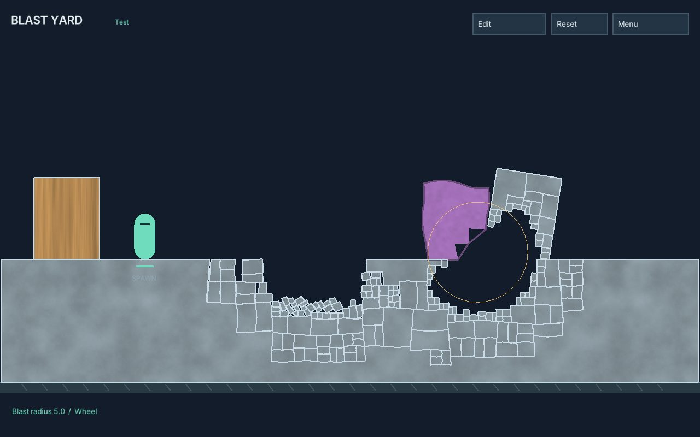
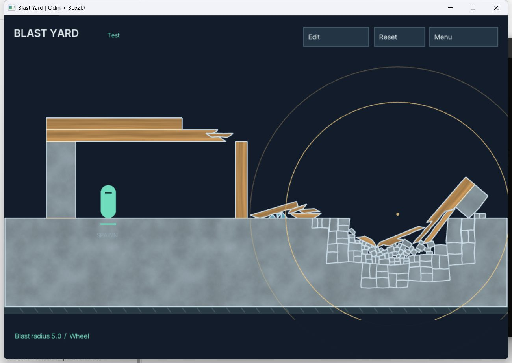
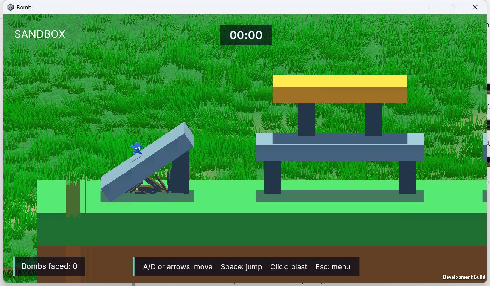
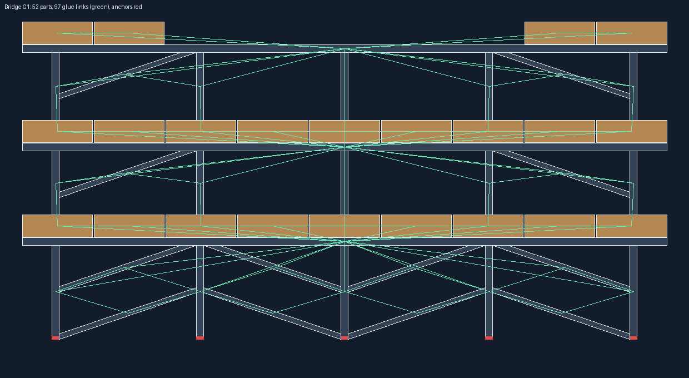
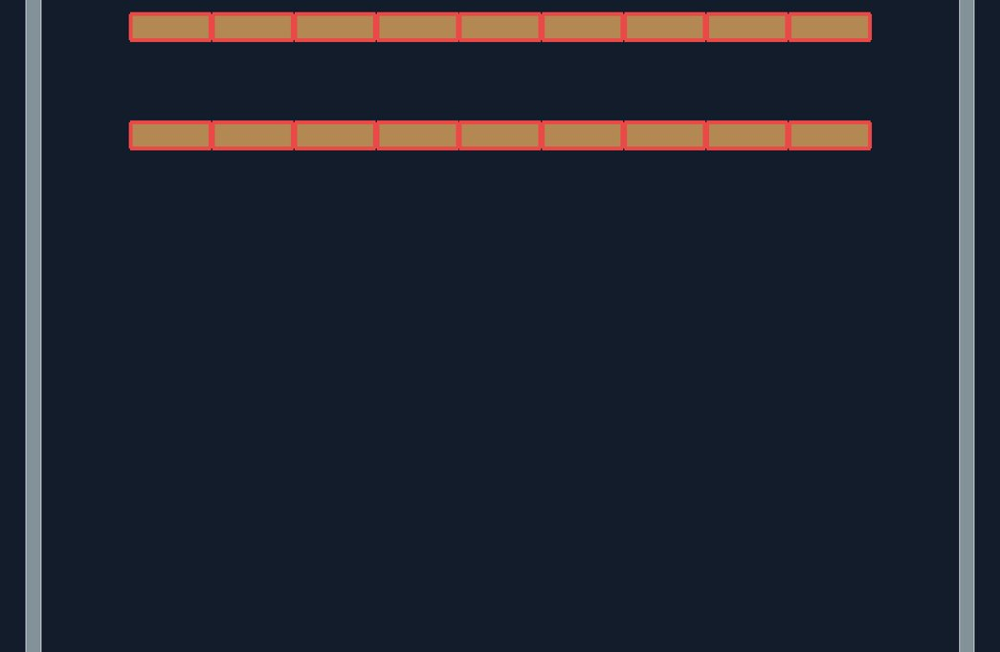
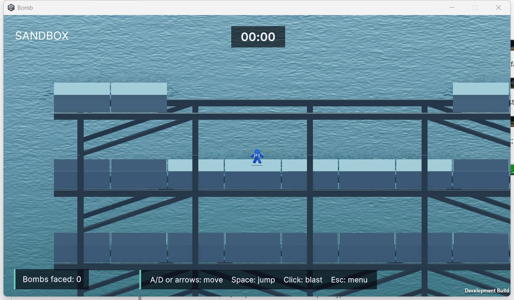
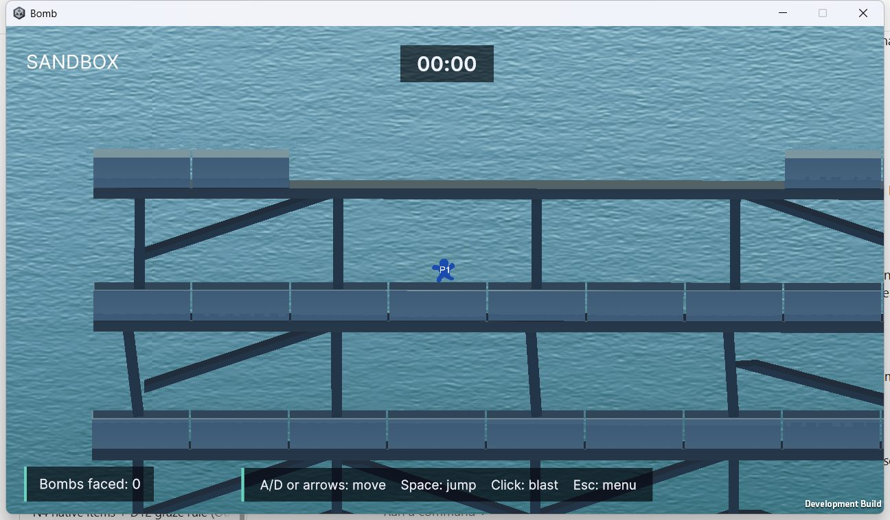
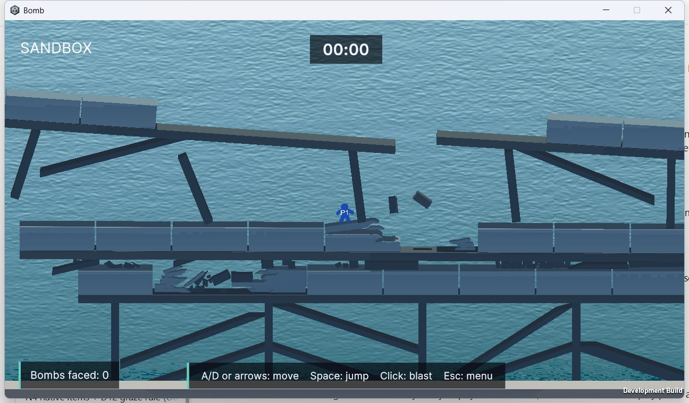

# G1: Odin destruction in Darryn's 2.5D (design spike, 2026-11-12)

Author: Claude Opus 5.5 (task G1). Inputs: owner principle in `integration/ALPHA-SYNC.md` Phase G; captures in
`integration/review/destruction-2026-11/`; F2 report `integration/review/performance-2026-11.md`; layout contract
`integration/contracts/level-layout-v4.md`; Odin `alpha-sync` 3aed89e (read only).

The owner's principle, which this design does not trade away:

- The destruction is the soul of the game. Every piece is a simulated, interactable body sent over the wire.
- **What's there is what you get.** What you see is exactly what you collide with, and it all fits together intuitively.
- Toughness comes from the owner's tuned **materials** and **connectors/glue**. Never from an indestructible flag or a
  decoration-only status.

## 1. Summary

**What went wrong.** The merge kept Odin's simulation but lost how it *reads*:

1. Every fragment is extruded to its tile's full depth: 4 units on the Bridge, 10–11 on the yards. So a 0.2-unit chip
   is drawn as a 0.2 × 0.2 × 4 stick, and a crater is drawn as a narrow slot through the level.
2. C6 turned half of Darryn's level into non-physical decoration: 88 of 110 Bridge tiles, 29 Tower pillars and
   8 Yard pillars. Every "Carve" tile is anchored on every edge, so blasted decks never drop debris. Overlaps were
   trimmed, nothing is glued, and the walls are indestructible.
3. Any change to a level rebuilds all of its meshes (F2 cause 1). That is where the explosion lag comes from.

**What I recommend.**

- **Layout:** turn Darryn's tiles into an Odin authored layout. Each tile becomes a part with a real material.
  Front/rear duplicates merge onto the play plane. Where tiles overlap, the plane is split between them and the shared
  seam is glued. Anchors go only where something rests on ground. Nothing is indestructible.
- **Depth:** draw each piece at a depth set by its own area, `depth = clamp(√area, 0.1, band)`, inside a
  **1.6-unit play band**. The same native data gives the same picture on every client. Darryn's extra depth becomes
  backdrop: a darker back wall behind terrain, and his scenery behind structures.
- **Presentation:** meshes persist and are split into chunks. A chunk is rebuilt only when its own cells change.
  Darryn's meshes are not clipped per fragment.

**The prototype works.** The flag is `--bom-g1`, the level is the G1 Bridge (`integration/fixtures/levels-g1/`), and
`integration/tools/g1/Start-BridgeG1.ps1` launches it. Darryn's 110 tiles become 52 physical parts with 97 glue links
and 5 anchored truss feet. It passes native validation and stands on the real server, and a blast now splinters the
planks, drops the bay and piles debris on the deck below.

The new presenter removes F2's main cause of lag. On Classic Yard, GC drops from 2,632 to 16 MB/min and p95 from 23.8
to 17.2 ms, and drawing a blast costs under 1.5 ms. Two things are left, both for Lane N:
- the G1 Bridge is fragile under its own weight (glue capacity is global, G-N1);
- while it collapses, the *client native update* hitches at 26–36 ms (G-N5).

Details are in section 6.

**Owner decisions needed:** the boundary (section 3.5), the material table (section 3.2), how Bridge supports work
(section 3.4), and the band depth and backdrop look (section 4). The task list is in section 8.

## 2. Captures and what is lost

Same idea in each source: a blast into a solid mass and one into a structure; one frame about 0.35 s after the blast
and one after it settles. Raw logs and the capture scripts are in `integration/evidence/G1/captures-20261112/`.

| # | Source | Frame | What it shows |
|---|---|---|---|
| 01–04 | Odin raylib sandbox, `--capture-frames` (deterministic falling bombs on the 17 × 3 destructible floor + 4 material blocks) | start, mid-blast, 10 s, 40 s |  Crater with 0.3–1 unit chunks; debris fills it and stays; blocks tumble into the crater |
| 05–09 | Odin sandbox, interactive: stone piers + mortared wood deck + wood posts + glass (layout in evidence `tools/sandbox-structure-layout.json`) | start, 0.35 s, settled |  Splinters hang from mortared deck ends; the broken plank leans into the crater; chunk sizes read immediately |
| 10–13 | Pre-merge package `BOM-Windows` (classic yard, Elimination bombs) | start, round start, blast, settled |  Small green chips burst from the grass plank. The stack topples at the start (C2b) |
| 14–17 | Current package `2026-11-12b`, Classic Yard | start, 0.35 s, settled |  A table leg breaks into long sticks; the ground crater is a thin slot; tile colours pop between intact and fragment art |
| 18–21 | Current package, Bridge | start, 0.35 s, settled |  Clean holes in the decks, no flying debris, truss untouched inside the blast radius, blasted tiles turn from blue to tan |

Notes on the runs. In the pre-merge package every scripted click came back `status=3` (Expired), which is the
pre-C2e click-timestamp bug, so its blasts are Elimination bombs instead. Its first one-window attempt timed out while
connecting (slow 12 s first load); the two-window rerun was clean. The sandbox's own interactive window cropped under
150 % DPI, so it ran with `__COMPAT_LAYER=DpiUnaware`.

**What is lost, concretely:**

| Quality | Odin (sandbox, pre-merge) | Now (2026-11-12b) | Cause |
|---|---|---|---|
| Piece size and density | Chunks 0.1–1 unit, many per crater (sandbox frame 600: ~150 in one crater); chips read as chips | The same cells in the sim (native is unchanged), but drawn 4–11 units deep, so each chip is a stick or slab and density reads as "a few planks" | Extrusion depth = the source's `depth` interval (`BomClientBehaviour.Accept` fallback; `BomSourcePresentation` clips Darryn's whole-depth mesh by each cell's prism) |
| Depth / stick look | Flat 2D (sandbox); thin slabs (pre-merge classic yard) | Long sticks (Classic Yard table legs, frame 17); deck fragments are full-depth blocks | Same |
| Tumble and settle | Pieces tumble, roll into the crater and settle on each other (sandbox 03–04) | Bridge: nothing falls; holes only (frames 19–21). Classic Yard: the table falls but its legs are sticks | C6 "Carve → anchored on every edge": every piece that still touches the original outline stays pinned |
| Crater readability | A bowl outlined by the chunk edges | A thin vertical slot through 10–11 units of ground (frame 17); colour pop at the hole's edge | Full-depth extrusion; intact art vs fragment palette |
| Standing on / pushing debris | Debris is walkable and pushable everywhere | Little debris exists on the Bridge. The truss looks solid but is decoration you pass through | C6 off-plane decoration; anchored-every-edge decks |
| What you see is what you hit | Yes | No: Bridge truss (88 tiles), Tower pillars (29), Yard pillars (8) are drawn but not physical; invisible indestructible walls | C6 mapping |
| Explosion moment | Immediate | Classic Yard: about 0.35 s after a blast the scene has not yet changed (frame 15); F2 measured 25–35 s rebuild windows | Full rebuild per revision (F2 cause 1) |

## 3. Design A: Darryn's tiles as an Odin authored layout

### 3.1 Invariants (checked by the exporter, so a level that breaks one fails to export)

- **I1 Physical = visible.** Every tile inside the arena is a part, or a declared backdrop (behind the band, darker,
  no walkable top). Nothing is "off-plane decoration".
- **I2 No indestructible.** No source is `indestructible`, and no source is `fixed` unless it is invisible boundary
  geometry the owner chooses to keep (section 3.5).
- **I3 Anchors only at real support.** Anchor segments sit only on edges that rest on ground or bedrock (or a wall, if
  the owner keeps walls). Never "anchored on every edge".
- **I4 Toughness from materials and glue.** Each part has a palette material; joins are glue links. No `allowed_overlaps`.
- **I5 Settles.** A spectator on the real server sees the world revision stay constant for 35 s with no blasts
  (C2b check).

### 3.2 Mapping rules (the G1 Bridge generator implements them: `integration/tools/g1/Build-BridgeG1.py`)

1. **Tile → part.** The outline is the tile's XY silhouette from its world transform. Rotated boxes become rotated
   quads (the Bridge braces are ±18.7°). Non-box meshes, such as the Yard rocks, need an authored proxy, as today.
2. **Front/rear duplicates merge.** Tiles with the same XY outline become one part, and the report keeps both paths.
   On the Bridge, 110 tiles become 67 members. Members that only existed off-plane (truss, pillars) come onto the plane.
3. **Overlaps → partition + glue, never a gap.** When two members overlap in XY, the continuous member keeps the
   overlap and the other is cut at its face. The priority is ground > decks and girders > posts > braces. The new
   shared edge gets a glue link. Example: posts that ran through the decks become runs between decks, and braces are
   clipped to the post and girder faces. This is not C6 trimming. C6 trimmed only to get past native's overlap check
   and left the tiles unconnected. Here every cut becomes a glued seam, so the structure holds by its connectors.
4. **Glue every contact.** Glue goes on every pair within the native glue fillet (0.2 units). Darryn's 0.07 gaps
   between deck tiles, the 0.02–0.03 deck-on-girder gaps and the cut faces are all glued. Blast strength comes from
   the materials: native fails a glue seam at `min(connection_strength)` of the two parts (`sim_destruction.odin:370`).
   Load strength does not yet come from the materials (section 7, G-N1).
5. **Material map.** One table per level maps Darryn's material asset to a palette entry. Proposed:

   | Darryn's use | Palette entry | Why |
   |---|---|---|
   | Bridge deck tiles | Wood (built-in) | Planks: splinters and strips, as in the sandbox |
   | Bridge truss, posts, girders, braces | custom **steel** = Stone base, toughness 1.25, blast resistance 4, navy | Tougher than wood, still breaks near a hit (subdivision 43.75 fails within 0.6 units, glue within 2.5 at radius 5). Toughness above ~1.4 would make it unbreakable by one bomb (max blast load is 50), which is indestructible in disguise |
   | Yard ground and earth tiles | custom earth (Stone base, as C6) | Unchanged |
   | Yard rocks | Stone | |
   | Tower blocks and pillars | Stone (as C6); pillars could be a separate "column" custom | |

6. **Motion.** Parts are dynamic by default and held up by glue to anchored parts. Only parts with an I3 support are
   `anchored`, with segments on exactly the supported edges.
7. **Pinned terrain.** Darryn's `Carve` behaviour means "terrain that never falls". In Odin terms that is the ground
   mass anchored on its bottom edge (bedrock). Pieces cut free fall. Today's "anchored on every edge" keeps floating
   fragments pinned.

### 3.3 Tower and Yard (for G5/G6, not prototyped)

- **Tower:** the 29 pillars come onto the plane and are anchored at the ground. Floors are glued onto the pillars.
  The 46 floor tiles that C6 anchored "at pillar contacts" become plain dynamic parts glued to the pillars. Darryn's
  `fallWhenUnsupported` then falls out of the simulation instead of a policy flag.
- **Yard:** ~130 ground tiles overlap by up to 0.39. They get partitioned and glued instead of trimmed, and the ground
  mass is anchored at its bottom edge. To stay under native limits (1,024 parts, 1,024 glue links), touching
  same-material ground tiles in a column can become one compound part (up to 64 parts per source). The 8 pillars come
  onto the plane.

### 3.4 Supports: the Bridge stands on nothing

Darryn's Bridge has no ground under it. The lowest truss posts end at y = −0.27, above a 25-unit drop, and the decks
end 3.5 units short of the walls. The prototype anchors the five lowest post feet ("piles in the riverbed"); the
generator's `--abutments` option also anchors the deck ends. **Owner decision:**

- **(a) Piles (prototype):** anchor the five feet, and optionally draw piles going down into the water.
- **(b) Abutments:** extend the end decks to banks at x = ±18 and anchor them there.
- **(c) Both.**

### 3.5 Walls and the boundary

Today the side walls and the bottom boundary are `fixed` + `indestructible` + hidden. Options:

- **A. Keep them as invisible boundary colliders.** Debris and players bounce off thin air at x = ±18. This is the
  smallest change, but it is the one place where what you see is not what you hit.
- **B. Remove them (prototype).** Leaving the arena is death by kill bounds (already x = ±18), and debris past the
  fragment-cull bounds is deleted. Over water or sky this reads naturally.
- **C. Visible, destructible bedrock walls.** Thick custom "bedrock" (Stone base, high toughness ≤ 1.4, high blast
  resistance), anchored at the bottom. They are visible, a blast can chip them, and they still hold the arena.

My recommendation: B for the Bridge, C for the Yard and Tower, where a ground mass meets the screen edge. **The owner
decides.** No option includes a visible indestructible piece.

## 4. Design B: depth from the 2D simulation

Physics is 2D. Depth is only how a piece is drawn. The question is what depth makes debris look like the chunk it is.

| Option | How | Verdict |
|---|---|---|
| A. Full source depth (today) | Extrude each cell to its tile's z interval | Sticks and slots. Rejected |
| **B. Per-piece depth from area, inside a play band (recommended)** | `d = clamp(k·√(piece area), d_min, band)`, centred on the player plane, quantised to 0.02 | A pure function of native piece outlines, so it is deterministic across clients and late joins. An intact slab fills the band; a 0.3-unit chip is about 0.3 deep (a cube); a strip is plank-shaped. A piece that splits off gets its own depth |
| C. Scooped craters | Keep full depth and carve a bowl into z around each blast | Needs blast history that is not in the state, so late joiners and replays draw it differently. It looks like a 3D hole you could step into, which breaks what-you-see-is-what-you-get. Rejected |
| D. Depth slices | N parallel 2D sims, one per z slice | Multiplies cells and physics. Players live in one slice, so the other slices are untouchable. Heavy Lane N work. Rejected |
| E. Per-cell depth | Depth from each cell's own area | Jagged within one rigid chunk. Rejected in favour of per piece |
| F. One thin slab for everything | Constant depth | No sticks, but big and small read the same. Second choice |

**Parameters (prototype defaults; flags `--bom-g1-band`, `--bom-g1-min-depth`, `--bom-g1-depth-scale`):**

- band = 1.6, which is at least the 0.9-unit player capsule, so a player never looks inside or behind a slab;
- d_min = 0.1, the native minimum fragment width;
- k = 1.

Pieces are what native regroups after a blast (`piece_id`). Glue welds a structure into one rigid piece, so an intact
bridge is band-deep and each piece knocked off it gets its own smaller depth.

**Backdrop.** Darryn's depth beyond the band is backdrop and is never physical:

- **Terrain (Yard ground, Tower base):** a static back wall from z = band/2 to Darryn's back face. It uses the
  authored intact outline, is drawn darker with no grass or top cap, and is never rebuilt. A crater reads as a hole in
  the front layer with dark earth behind, which is the convention 2D-physics games use for background walls.
- **Structures (Bridge, Tower floors):** no back wall. Darryn's scenery (water, sky, hills) is the backdrop.

The prototype implements the band and hides Darryn's tiles; the terrain back wall is task G3. The back wall must never
show a walkable top. That is what keeps it from reading as solid.

## 5. Design C: presentation without per-change mesh churn

**Today** (`BomClientBehaviour.Accept` and `BomSourcePresentation`), on every world revision:

- a new "Native geometry" GameObject is built, with every terrain batch re-merged into new `Mesh` objects, and the old
  tree is destroyed;
- the source presenter re-plans and re-clips Darryn's meshes cell by cell with the prism clipper, behind a 1.5 ms
  budget that is only checked between steps;
- per-cell fallback geometry is cached, but the batches are not.

F2 measured the result on Classic Yard (3,549-cell source): 25–35 s of geometry work at p95 23–34 ms, up to 145 frames
per minute over 33 ms, 2.5–3.0 MB of GC per frame (5.8–7.0 GB/min). It repeats at every round start, because a new
epoch clears everything.

**Proposed** (prototype: `Assets/BOMIntegration/Runtime/BomG1Presenter.cs`):

1. **Persistent bodies.** There is one Transform per native body (pose kind + piece or cell id), kept across
   revisions and reused from a pool. The pose loop moves them as today.
2. **Per-cell geometry cache** keyed by (cell id, depth bucket). Native cells never change shape, so a cell is
   extruded once. Only cells a blast creates get built.
3. **Chunked meshes.** A large body is split into chunks (4 × 4 world units × material). Each chunk keeps a hash of
   its cell ids and depth bucket and is rebuilt only when that hash changes, into the same `Mesh` object (`MarkDynamic`,
   `SetVertices(List)`, reused lists). A blast on a 3,549-cell ground rebuilds the 2–6 chunks it touched, not the
   whole level.
4. **No per-fragment clipping of Darryn's meshes** in the play band. His art supplies materials (looked up by tile
   path and applied to the extrusions) and the static backdrop. That removes `BomPrismClipper` and the plan/clip jobs
   from the blast path.
5. **Next step (G2):** assemble chunk buffers with `Mesh.AllocateWritableMeshData` / `NativeArray` in a Burst job, so
   the managed heap is not touched at all. Instancing does not help here, because every fragment is a unique shape;
   chunked batching already keeps draw calls in the hundreds. `BatchRendererGroup` is not needed at these counts.

**Expected gain from F2's numbers, and measured.** F2's Classic Yard rebuild window was 25–35 s of 2.5–3 MB GC per
frame. With persistent bodies it should cost one first build, and a blast should rebuild only the chunks it touches.

Measured on the same level and blasts (section 6.3):
- GC: 2,632 → 16 MB/min;
- p95: 23.8 → 17.2 ms;
- frames with more than 5 ms of presentation: 1,590 → 2;
- first build of the 3,549-cell yard: about 15 ms in one frame.

The prototype keeps its caches only within an epoch. G2 adds keeping them across a round-start epoch whose cells did
not change (F2's 1a), so a round start costs the same as a join.

## 6. Prototype: the Bridge rebuilt the G1 way

**How to run it.** `powershell -File integration/tools/g1/Start-BridgeG1.ps1 [-Clients 2] [-Band 1.6]`. It needs a
front-door game build that contains `BomG1Presenter`, by default `integration/build/validation/Game-Mono/Bomb.exe`
(build it with `Build-BomGame.ps1 -Backend Mono`). The launcher writes `%TEMP%om-g1-levels`, which holds the
game's shipped layouts with `BridgeLevel.json` replaced by the G1 Bridge, and starts the game with `--bom-g1` and
`--bom-levels` pointing at that folder. Then pick ONLINE > HOST GAME > BRIDGE > START. Every window needs the flag. Without `--bom-g1`
nothing changes: Build, Content, Rounds and the front-door gate pass with the flag off (section 6.4).

**What the flag does.**

- `BomClientBehaviour.Accept` hands topology to `BomG1Presenter` instead of the per-revision batch path.
- It runs without the visual registry, as `--bom-no-visual-registry` already allowed, so there is no clipped source art
  and no manifest pin.
- It hides every `DestructibleObject` renderer after remembering its material.

`--bom-levels` makes the host's server load the G1 layout for the BRIDGE entry. The shipped `BridgeLevel.json` and
the scenes are untouched.

### 6.1 The G1 Bridge layout

`integration/fixtures/levels-g1/BridgeLevel.json`, generated from Darryn's scene, which is only read. A per-member
report sits beside it (`.g1-report.json`).

C6's shipped Bridge, for comparison: 22 deck tiles anchored on every edge plus 3 indestructible walls; the 88 truss
tiles are not physical.

| | C6 Bridge (shipped) | G1 Bridge |
|---|---|---|
| Darryn tiles accounted for | 22 physical, 88 decoration | 110 (67 members after merging front/rear, cut into 52 parts) |
| Parts | 22 decks + 3 indestructible walls | 22 decks (wood), 3 girders, 15 post runs, 12 braces (steel) |
| Glue | 0 | 97 links |
| Anchors | every edge of every deck | 5 post feet only |
| Indestructible / fixed | 3 walls | none |
| Cells at load | (C6 report) | 731 (native `--validate-layout` PASS, gameplay manifest `dc30b00e…b0d0`) |

**Stands on its own.** On the real server, with the current package and no blasts, there were 3 snapshots in the
first ~3 s (731 → 726 cells as a few seams settled) and then none for 10+ s. A blast on the middle deck splinters the
planks; a second blast on the lower deck drops the bay above it, and the debris piles on the lower deck.
(Evidence: `integration/evidence/G1/`, runs `g1try3*`.)

### 6.2 Captures next to the originals

Same window, same clicks (one on the middle deck, one on the lower deck). Run logs:
`integration/evidence/G1/prototype-20261112/g1build2/`.

| | Shipped Bridge (2026-11-12b) | G1 Bridge (`--bom-g1`) |
|---|---|---|
| Start |  |  |
| Deck blast, 0.35 s |  |  |
| Lower blast, 0.35 s |  |  |
| Settled |  |  |

What the comparison shows:

- **One truss, and it is real.** The shipped Bridge draws two decoration trusses you pass through. G1 draws one, on
  the play plane, and it is what you collide with. 88 decoration renderers are hidden by path, and Darryn's own
  materials (blue-grey deck, navy steel) dress the extrusions, so it still reads as his bridge.
- **Planks splinter.** The blasted deck ends break into wood strips. Steel members and splinters fly mid-air, each
  drawn at its own depth: a chip is a chip, not a 4-unit stick.
- **Structures fall.** Cutting the lower bay drops the middle deck onto the lower one; the top girder sags into the
  gap and debris piles up where it lands. In the shipped Bridge every deck stays pinned and only holes appear.
- **No colour pop.** There is no intact-art versus fragment-palette switch.
- **Visible weakness (needs G-N1).** Even before any blast, a few lower-bay posts and braces come loose while the
  structure settles (731 → 726 cells and 52 → 51 bodies in the first ~3 s, then no change until the first blast).
  After one blast the bay above it fails readily. Global glue capacity (280 per unit length) is the limit; material-
  derived capacity (G-N1) is the fix. Anchoring more would be the wrong fix.
- **Not yet done:** the terrain back wall (no terrain on the Bridge); the camera reframes after big collapses (stock
  behaviour); the deck top faces use the side shade, which is a small material-slot tweak for G3.

Earlier step, kept for reference: the same G1 layout drawn by the shipped presenter (`--bom-no-visual-registry`,
full-depth extrusion of every part, Darryn's decoration still drawn): `31-…`, `32-…`, `33-…`. The first G1 build,
before tiles were hidden by path, is `39-…`.

### 6.3 Frame times (F2 protocol, 1 window, Sandbox, same scripted blasts)

**Setup.** One build: `Game-Mono`, built from this branch with the prototype. Harness:
`integration/tools/g1/Run-G1Perf.ps1`, summary `integration/tools/g1/Summarize-G1Perf.py`, which uses F2's
analyser. Same machine as F2, running on battery, 1280 × 720 windowed, D3D11, 60 fps cap, 100 s per run.

Four host click-blasts happen at 30, 42, 54 and 66 s after hosting, at the same window positions; 2–3 of the 4 were
valid (the others started inside solid). The probe ran with the new opt-in `--bom-perf-manual`. The stock probe sets
`DrivenByRoundScenario`, which drops all player input, so F2's runs could not blast at all.

The **blast window** is the frames from 0.5 s before to 3 s after each world-revision change. Evidence:
`integration/evidence/G1/perf/perf-20261112T205556-*`. Two failed attempts are kept beside them:

- `attempt1-relative-out-no-blasts`: the player resolved a relative `-logFile` against its own folder;
- `attempt2-probe-blocked-input`: the stock probe swallowed the clicks, and a Unity Hub helper process failed the
  Classic precheck.

| Run | p50 | p95 | p99 | max | > 33 ms per min | GC MB/min | presentation+geometry p99 / max ms | frames with presentation > 5 ms | revisions | blast window p95 / max | blast window GC MB |
|---|---|---|---|---|---|---|---|---|---|---|---|
| Classic Yard, stock | 16.7 | **23.8** | 28.0 | 125.7 | 7.8 | **2632** | **25.3 / 59.1** | **1590** | 5 | 20.5 / 125.7 | 581 |
| Classic Yard, `--bom-g1` | 16.7 | **17.2** | 17.8 | 79.4 | 4.2 | **15.9** | **0.11 / 14.8** | **2** | 5 | 17.4 / 79.4 | 7.1 |
| Bridge (shipped C6 layout), stock | 16.7 | 17.1 | 18.3 | 67.9 | 6.0 | 107.9 | 0.25 / 26.5 | 6 | 3 | 17.6 / 67.9 | 157 |
| G1 Bridge, `--bom-g1` | 16.7 | 17.9 | 19.4 | 54.6 | 28.8 | 17.8 | 0.27 / 11.6 | 1 | 46 | 18.7 / 54.6 | 12.6 |

What the numbers say:

1. **F2 cause 1 is gone under the G1 presenter.** On Classic Yard, the same level, layout and blasts:
   - GC drops from 2,632 to 16 MB/min (99.4 %);
   - p95 drops from 23.8 to 17.2 ms;
   - frames spending more than 5 ms in presentation drop from 1,590 to 2.

   The two remaining frames are the one-time first build of 3,549 cells (about 15 ms in one frame, instead of 30 s
   of rebuilding). Per revision, the G1 presenter took 0.5–3.3 ms and rebuilt only the touched chunks
   (`BOM G1 APPLY … rebuilt=` lines in `host.log`).
2. **A blast costs almost nothing to draw.** On the G1 Bridge, presentation p99 is 0.27 ms, with 46 revisions in
   100 s because the structure really collapses. The stock Bridge spends up to 25 ms presenting one blast, and on
   Classic Yard up to 59 ms.
3. **The G1 Bridge's remaining hitches are native, not presentation.** 45 of its 48 frames over 33 ms have 26–36 ms
   in `native_ms`, the client's native update. That is the client simulation and prediction stepping a collapsing
   structure of dozens of moving glued bodies, which the shipped Bridge never had because nothing in it moves. This
   is a new Lane N item (G-N5): profile `bom_client_update` with many moving pieces, the prediction collision-window
   rebuild and replay in particular. The server reported 0 overruns in every run. The stock Bridge shows the same
   native spikes, smaller (5 of 10 hitches), after its blasts.
4. **Steady state is unchanged:** p50 16.7 ms in all four runs.

### 6.4 Gates with the flag off

All four gates ran on this branch's final code, which is commit 8431ac7: the prototype plus the `--bom-perf-manual`
probe opt-in. No Unity source changed after it. None of the gate runs passed `--bom-g1`. The native side was the pinned
owner-native checkpoint (DLL sha256 `f87d0cd6…0a965`).

| Gate | Result | Evidence |
|---|---|---|
| Build (`Build-BomPlayers.ps1 -Backend Mono`, and the Game-Mono front-door build) | PASS | `integration/build/validation/Game-Mono` (2026-11-12 15:55; contains `--bom-g1` and `--bom-perf-manual`) |
| Content (`-Suite Content`) | PASS, 1555 protected files verified | `integration/evidence/M0/Test-Content-20261112T210533027Z.json` |
| Rounds, yard (`Test-NetworkRounds.ps1`, rebuilt network player) | PASS: both clients and the observer agree on `[1,3,0] [2,3,0]`, and all exit codes are 0 | `integration/evidence/M8/unity-rounds-20261116T161403873540Z` |
| Rounds, draw | PASS: both clients and the observer agree on `[1,0,1] [2,0,1]`, and all exit codes are 0 | `integration/evidence/M8/unity-rounds-20261116T161551473318Z` |
| Front door (`Test-FrontDoor.ps1 -SkipBuild -Backend Mono -Level ClassicYard`) | PASS: all 17 checks true, `orphans_killed: []` | `integration/evidence/M8/frontdoor-20261116T161702566311Z` |

The earlier front-door pass (`frontdoor-20261112T203002710838Z`) predates the probe change and is kept for history.
A Rounds run on 2026-11-12 was stopped mid-build at the owner's request. It produced no result and is not counted as
an attempt.

## 7. What needs Lane N

| ID | Need | Why | Size |
|---|---|---|---|
| G-N1 | **Glue load capacity from materials.** Today the force capacity is global (`MORTAR_STRENGTH` 280 per unit length, `SEAM_TOUGHNESS` 0.4 s, `sim_mortar.odin:122`); only blast failure uses the materials (`min(connection_strength)`). Proposal: capacity = 280 × min(toughness of the two materials), or an optional per-link strength in the level's glue records (canonical data) | Steel truss joints should outlast wood plank joints under load. On a 29-unit three-deck bridge, the 0.34-long post seams carry most of the weight | M (+ tests, + E1) |
| G-N2 | **Report each glue link's sample count** in `--validate-layout`, and fail a link with zero samples | `glue_add` silently drops a link whose parts are more than 0.2 apart; an exporter cannot tell | S |
| G-N3 | **Larger glue and part budgets, or a group glue record** ("glue all contacts within these sources") | Darryn's Yard (~130 tiles) and Tower can approach 1,024 links once everything is glued | S |
| G-N5 | **Client native update cost while a structure collapses.** On the G1 Bridge, 45 of 48 frames over 33 ms spend 26–36 ms in `bom_client_update`, while presentation stays under 1.5 ms (section 6.3). Profile the prediction collision window and replay with dozens of moving glued bodies; bound the per-frame work or move it off the main thread | Real Odin destruction means many moving pieces; the client must keep up as the server does (0 overruns) | M |
| G-N4 | (Optional) **Per-source settle report** in `--validate-layout`: simulate N ticks headless and report the revision changes and the cells lost | Makes I5 a one-command export check instead of a Unity run | M |

Not needed from Lane N:

- **Depth:** it is visual. The client computes it from outlines, and the existing source `depth` interval (excluded
  from the gameplay hash) already serves as the per-source band cap.
- **Anchors:** existing anchor segments cover I3.
- **Wire and ABI:** no change.

## 8. Task breakdown

Lane U runs in `Desktop\Bomb-integration`; Lane N in `Documents\BOM` (`alpha-sync`). Native changes reach Unity
through E1. Sizes: S < 1 h, M 1–3 h, L = several sessions. The owner decisions (OD) are listed after the table.

| Order | ID | Task | Model | Lane | Size | Needs |
|---|---|---|---|---|---|---|
| 1 | **G2** | **Presentation core for every level.** Make `BomG1Presenter`'s persistent, chunked, cached bodies the only cell path: remove the per-revision batch rebuild in `Accept`. Keep bodies and caches across an epoch whose cells did not change (F2 fix 1a). Move chunk assembly to `Mesh.MeshData` / `NativeArray` (+ Burst) for zero managed GC. Retire per-fragment prism clipping of Darryn's meshes in the play band. Re-run F2's protocol on all four levels with 1 and 2 windows | Opus (T1) | U | M | — |
| 2 | **G-N1** | **Glue load capacity from materials** (section 7). Capacity scales with the weaker material's toughness, or an optional per-link strength in level glue. Add tests: a steel seam outlasts wood under load; blast behaviour unchanged | Codex high (T1) | N | M | OD-2 |
| 2 | **G-N5** | Client native update cost with many moving pieces (section 7): profile `bom_client_update` on the G1 Bridge collapse, then fix the prediction collision-window and replay cost | Codex high (T1) | N | M | — |
| 2 | **G-N2** | `--validate-layout` reports each glue link's sample count and fails links with zero samples; raise or group the glue budget (G-N3) | Codex medium (T2) | N | S | — |
| 3 | **E1-G** | Bring G-N1/G-N2/G-N5 into Unity (A1 steps, re-export levels, gates) | Opus (T1) | U | M | G-N1, G-N2, G-N5 |
| 3 | **G3** | **Depth from shape as the default look.** Make the band and `clamp(√area)` depth the default for all levels (no flag). Add the terrain back wall (darker, no top cap, never rebuilt). Apply Darryn's material per source through the registry instead of scene paths. Keep the stock look selectable by a flag for one release | Opus (T1) | U | M | G2, OD-4 |
| 4 | **G5** | **Tile exporter v2** in `Editor/BomTileLevelBuilder.cs`: the section 3 mapping for any tile scene (merge duplicates, partition + glue, material table, anchors at real supports only, invariants I1–I5 as export failures). It reads mesh silhouettes directly, so it also covers non-box tiles with proxies. It replaces the Python generator | Opus (T1) | U | L | OD-1, OD-2, OD-3; G-N2 helps |
| 5 | **G6** | Re-export Yard, Bridge and Tower with G5. Settle check on each (35 s, revision constant); tune materials and glue with the owner; capture them next to G1 | Sonnet (T2) | U | M | G5, E1-G |
| 5 | **G7** | Classic Yard: bring its 8 off-plane pillars (depth 1.06..1.76) onto the plane, glue its tables, apply the boundary decision | Sonnet (T2) | U | S | G5, OD-1 |
| 6 | **G8** | Boundary per OD-1: remove the walls (B) or add destructible bedrock (C) in all four levels, and check the kill and fragment-cull bounds | Sonnet (T2) | U | S | OD-1 |
| 7 | **G9** | Performance and feel pass: F2 protocol, 2 windows, long human Elimination round with blasts on every level; Prediction suite; 30-minute soak | Opus (T1) | U | M | G2–G8 |
| 8 | **G10** | Repackage (as F4) with the G look as default | Sonnet (T2) | U | S | G9, owner check |

**Owner decisions:**

- **OD-1 Boundary** (section 3.5). Recommended: B for the Bridge, C for the Yard and Tower.
- **OD-2 Material table** (section 3.2), including whether a "steel" custom joins the palette.
- **OD-3 Bridge supports** (section 3.4): piles, abutments or both.
- **OD-4 Band depth and backdrop look** (section 4). Judge it in the prototype with `--bom-g1-band`.

## 9. G2 results: one persistent cell path for every level (2026-11-16)

`Runtime/BomCellPresenter.cs` (renamed from `BomG1Presenter.cs`, same GUID) is now the only cell path; no flag needed.
- **Persistent bodies:** keyed by pose kind and cell or piece id. Bodies with more than 192 cells are split into chunks by look and a 4×4-unit spatial tile, and a chunk is rebuilt only when its signature changes.
- **Epochs:** an epoch whose cells did not change rebuilds nothing (round start: 0.5–0.6 ms, `rebuilt=0`).
- **Geometry cache:** per-cell extrusions live in a native arena, keyed by cell id plus a shape hash, and compacted.
- **Assembly:** chunks are assembled with `Mesh.AllocateWritableMeshData` / `ApplyAndDisposeWritableMeshData`. Burst is not used because `Packages/manifest.json` is protected.
- **Warm-up:** one synthetic cell goes through the whole path at join (`BOM CELLS WARM ms=5–7`), so the first blast does not pay for JIT.

**Look.**
- An intact source (all its registry cells, one static piece) draws Darryn's own meshes: `intact=104/22/87` sources on Yard/Bridge/Tower.
- Fragments of a source are extruded over the source's own depth with his material. The material comes per (group, submesh) from the triangle under the cell centroid; UVs come from an exact planar fit of his UVs and are kept only when the fit is exact.
- Per-fragment prism clipping is retired in the play band.
- Kept for one release: the old per-revision batches with clipped source art, behind `--bom-clipped-source-art`. The source-capture and job-gate tools (`--bom-source-capture`, `--bom-source-job-gate`) imply that flag. The Soak and NativeProof source tools also still use the old path.
- Known difference on Classic Yard: where a fragment covers two materials (the grass/dirt edge), the edge follows cell outlines instead of the clipper's straight cut. There is also faint horizontal shading banding. See `integration/evidence/G2/zoom-before.png` and `zoom-after.png`. An exact per-material split could go to G3.
- Owner check: "it looks the same and feels smoother".

**Measurements.**
- Protocol: F2/G1, 100 s, 60 fps cap, the same 8 scripted host blasts at 30–72 s; 2 windows = host plus a guest.
- "before" = `--bom-clipped-source-art` in the same build: `integration/evidence/G2/perf/perf-20261116T172538`.
- "after" = final build with the warm-up: `warm-20261116T234500`.
- The pre-warm-up after runs are kept in `final-20261116T181559`.
- Summary script: `integration/tools/g1/Summarize-G2Perf.py`, output in `integration/evidence/G2/perf/summary.csv`. All runs `result=ok`, `resources_drained=True`.
- What is committed: run records, logs and the summary. The per-frame `host-perf.json`/`guest-perf.json` files and the screenshots (about 450 MB) stay on disk in those folders, untracked.

| Level, windows | GC MB/min | p95 frame ms | p99 frame ms | frames >33 ms /min | max present+geometry ms (blast draw cost) | max present GC bytes/frame |
|---|---|---|---|---|---|---|
| Classic Yard 1w | 2682 → 13.7 | 24.06 → 17.40 | 36.75 → 17.94 | 55.8 → 9.6 | 63.5 → 20.1 | 7643 → 748 |
| Classic Yard 2w | 2596 → 13.7 | 41.35 → 17.47 | 48.58 → 18.17 | 313.8 → 10.8 | 117.1 → 24.9 | 6980 → 497 |
| Yard 1w | 67.8 → 14.1 | 17.12 → 17.14 | 17.65 → 17.70 | 4.8 → 4.2 | 55.9 → 26.0 | 11073 → 717 |
| Yard 2w | 67.3 → 14.1 | 17.07 → 17.11 | 17.82 → 17.64 | 6.0 → 4.2 | 56.2 → 30.4 | 11737 → 650 |
| Bridge 1w | 166.5 → 13.7 | 17.06 → 17.03 | 17.66 → 17.36 | 7.8 → 6.0 | 42.2 → 19.5 | 4934 → 242 |
| Bridge 2w | 138.9 → 13.6 | 16.95 → 17.00 | 17.59 → 17.44 | 9.0 → 7.2 | 47.5 → 27.6 | 5336 → 320 |
| Tower 1w | 229.5 → 18.0 | 17.60 → 17.50 | 19.79 → 18.25 | 29.4 → 15.6 | 60.5 → 27.2 | 13903 → 788 |
| Tower 2w | 234.6 → 18.9 | 17.68 → 17.80 | 34.52 → 19.51 | 37.8 → 22.2 | 54.7 → 34.5 | 14838 → 815 |

- **Remaining GC (13.6–19 MB/min)** is the HUD/frame baseline. Cell presentation allocates ≤0.8 KB per frame (`present_gc`).
- **Warm-up effect** (max present+geometry, pre-warm-up → warm-up): Yard 36→26, Bridge 37→20, Tower 38→27 ms. That maximum is the first blast's frame. On Classic Yard only 8 ms of that 20 ms frame is the cell apply; the rest is other first-blast presentation outside the cell path. Later blasts cost 4–8 ms (apply log).
- **Remaining hitches** are the native client update on blasts: `native_ms` up to 50–69 ms (Bridge, Classic 2w). This is Lane N's G-N5, not presentation.

**Gates** (final code; see the G2 commit message for the result lines): Build (Mono), Content, Rounds yard + draw, front door `-Level Yard`/`Bridge`/`Tower` (17/17 each, orphans none; evidence `integration/evidence/M8/frontdoor-{yard,bridge,tower}-20261116T2337…/2338…`), and Prediction.

### 9.1 E1-G: native G-N5 in Unity (2026-11-17)

Unity now ships Odin `alpha-sync` f3a4e48 (G-N5 prediction hull cache, G-N2/G-N3 glue reporting; build tag 217547153414412003, DLL f9651cd4…).
The DLL is `-o:speed` plus `-debug` (`CompilerArguments`), unlike G-N5's headless numbers; the flag was not changed.
Same protocol and build path as above ("after" only), evidence `integration/evidence/E1-G/perf-20261117T051233`, summary `integration/evidence/E1-G/summary.csv`.
All 8 runs `result=ok`, 0 sleep events, `resources_drained=True`. The 2-window guest now writes `guest-perf.json` and exits 0 (harness fix below), so guest rows exist for the first time.

Host, G2 `warm-20261116T234500` → E1-G (1 window / 2 windows):

| Level | blast native_ms max | blast-window p95 ms | blast-window max ms | frames >33 ms /min | GC MB/min |
|---|---|---|---|---|---|
| Classic Yard | 57.4 / 68.9 → 20.9 / 18.5 | 17.51 / 17.72 → 17.04 / 17.01 | 99.6 / 112.9 → 49.0 / 48.1 | 9.6 / 10.8 → 3.0 / 3.6 | 13.7 → 13.9 / 14.0 |
| Yard | 18.2 / 24.9 → 3.4 / 3.9 | 17.15 / 17.19 → 16.92 / 16.85 | 54.3 / 60.9 → 35.7 / 48.1 | 4.2 / 4.2 → 0.6 / 1.8 | 14.1 → 13.9 |
| Bridge | 50.3 / 53.9 → 3.4 / 6.4 | 17.13 / 17.06 → 16.92 / 16.90 | 68.2 / 76.3 → 37.1 / 47.8 | 6.0 / 7.2 → 1.2 / 1.8 | 13.7 / 13.6 → 13.6 |
| Tower | 27.0 / 36.0 → 10.9 / 11.4 | 17.62 / 18.17 → 17.02 / 17.07 | 57.1 / 85.2 → 38.8 / 41.1 | 15.6 / 22.2 → 0.6 / 1.2 | 18.0 / 18.9 → 17.7 / 19.2 |

Guest (2 windows, 80 s window, new): native_ms max Classic 15.6, Yard 4.1, Bridge 5.6, Tower 10.8; blast-window p95 16.84–16.96 ms, max 46–49 ms; >33 ms 0.8–5.2 /min.

**What still causes the worst blast frames.**
- Native is no longer the cause except on Classic Yard, where 3 blast frames in a run still have `native_ms` 15–21 ms.
- Present+geometry peaks at 10–22 ms on the first blast only (Tower 18–21.5 ms, the others 10–17 ms).
- Most remaining >33 ms frames have native < 1 ms and present < 1 ms. They land 0.05–0.17 s *before* the blast's revision arrives, on host and guest at the same moment.
  This is the harness's own screenshot 250 ms after each click (`Shot`), not the game. The other one per run is an early frame at ~5 s, right after warm-up (e.g. Bridge 2w: 86 ms frame, `gpu_ms` 49, native and present ~0).

**Harness fix.** `BomFrontDoorScenario.Guest()` now ends cleanly when the perf probe has disabled the client (it waits for the probe to write its report and quit)
instead of dereferencing a null `Session` (FAIL, `Quit(4)`). `Run-G1Perf.ps1` keeps the process handles so exit codes are recorded, and writes `host_perf_json`/`guest_perf_json` into `run.json`.
`Summarize-G2Perf.py` adds guest rows and blast-window columns, including the worst blast-window frame split into frame:native:present+geometry:gpu.

### 9.2 G2b: first-blast hitch (2026-11-17)

Only the first blast of a run hitched. Proven with the opt-in `--bom-hitch-trace` (laps in the blast handler and topology apply,
input-system update time, and a timestamp before every player-loop subsystem; evidence `integration/evidence/G2b/trace-yard-1w-1..9`).
The orchestrator's guess (Mono JIT/marshal in the blast handler) was wrong for most of it. The handler itself costs 0.3–0.4 ms on its first call.
- (a) **Mouse-down frame (35–48 ms):** UI Toolkit's first pointer dispatch, `PreLateUpdate.UIElementsUpdatePanels` 24.8 ms, plus the
  Input System's first button event (`PreUpdate.NewInputUpdate` 3–4 ms). Fix: `BomPointerWarm` queues one synthetic left press/release on the
  real mouse at (-4096,-4096) at join and restores the pointer position. The blast callback ignores clicks for those 2 frames (`Swallowing`),
  so nothing is enqueued or sent. The handler body is now `Blast(time, warm)`, and a warm call (stats query, raycast, formatting; no log or enqueue) runs at join.
- (b) **First CELLS APPLY (present 13–18 ms):** not "every chunk": at join every source is intact, so no chunk exists, and the first blast builds
  only its new debris chunks (Yard 58 of 58). The cost was first use: Darryn's explosion clip is decompress-on-load with `preloadAudioData: 0`,
  so the first `PlayOneShot` decoded the mp3 (4.6 ms). The fragment chunk path had never run (looks, renderers, Build; 4.4 ms over the later blasts),
  and the blast view's reflection bind took 1.2 ms. Fixes: `BomGameAudio.PreloadEffects` (`LoadAudioData` on his effect clips, read by reflection,
  his script/assets unchanged). `BomCellPresenter` warm apply: at the first presentation the apply runs once with every source treated as broken, then
  the real apply replaces it in the same frame, so nothing from it is drawn (`--bom-no-warm-apply` turns it off). Join cost: Yard 26 ms, Bridge 34 ms.
  Last, one off-screen blast-view `Show` at join (removes itself after 0.35 s; not counted in `ExplosionVisuals`).
- Tried and dropped: `RuntimeHelpers.PrepareMethod` is a no-op on Mono (1167 methods in 7 ms, no change). Forcing JIT through
  `MethodHandle.GetFunctionPointer` cost 107 ms at join and gained ~1 ms once the warm apply was in.

Perf matrix `integration/evidence/G2b/perf-20261117T081300` (same protocol as 9.1; all 8 runs `ok`). Summary: `evidence/G2b/summary-first-blast.txt`
(`firstblast.py`: a blast = a cluster of frames with present > 1 ms, window −0.6/+1.4 s). E1-G → G2b, first-blast worst frame ms (present ms):

| Level | host 1w | host 2w | guest | blasts 2–8 max (host 1w/2w, guest) | >33 ms/min (1w/2w/guest) |
|---|---|---|---|---|---|
| Classic Yard | 49.0 (10.8) → 42.1 (5.3) | 48.1 → 40.6 | 48.7 → 42.6 | 39.5 / 43.5, 43.2 | 1.8 / 3.6 / 5.2 |
| Yard | 35.7 (14.2) → 23.7 (5.6) | 48.1 → 25.9 | 47.9 → 28.5 | 20.0 / 20.3, 20.7 | 0.0 / 0.6 / 0.0 |
| Bridge | 37.1 (13.0) → 23.7 (2.7) | 47.8 → 24.1 | 47.5 → 33.0 | 22.2 / 21.7, 20.7 | 0.6 / 0.6 / 0.8 |
| Tower | 38.8 (14.8) → 22.9 (3.7) | 41.1 → 28.2 | 46.3 → 28.1 | 26.8 / 29.0, 26.4 | 0.0 / 0.6 / 0.0 |

GC MB/min unchanged (13.5–19.2 host, 7.6–14.6 guest); `present_gc` peak stays a few hundred bytes (237–730 B, as in E1-G).
**What remains.** The first blast is now in line with the later ones. Classic Yard's blast frames (first and later, 40–43 ms) are native (13–19 ms) plus present, which is Lane N.
The Bridge guest's 33 ms frame has native 0.1 and present 0.04 ms. It lands 0.16 s before the blast arrives, when the harness first brings the host
window to the front (the 9.1 harness pattern; not proven further). Every blast frame that lands at 20–29 ms is native 3–6 ms plus present 2–6 ms on top of a ~12 ms frame, so it misses one vsync.
Gates: Build, Content (1555), Rounds yard+draw, front door Yard/Bridge/Tower, Prediction 6/6 (`evidence/M0/Test-Prediction-20261117T071000168Z.json`) pass.
